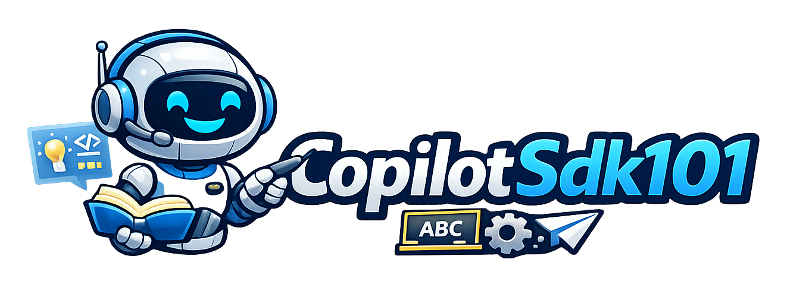

Progressive examples showing how to use the [GitHub Copilot SDK](https://www.nuget.org/packages/GitHub.Copilot.SDK) from .NET to build agentic coding tools.

## Prerequisites

- .NET 10
- `GitHub.Copilot.SDK` 1.0.26 (latest stable checked on 2026-10-26; restored automatically)
- An authenticated GitHub account with Copilot access. Run `copilot login` with the [Copilot CLI](https://docs.github.com/en/copilot/how-tos/set-up/install-copilot-cli), or supply a supported token through `COPILOT_GITHUB_TOKEN`.

Build all six examples with `dotnet build CopilotSdk101.slnx`. The package downloads and verifies its pinned runtime (CLI 1.0.103) during the first build, so that build needs access to GitHub releases. SDK sessions use the bundled runtime by default.

The examples use the runtime's default model. Set `COPILOT_MODEL` to choose a model available to your account; use `client.ListModelsAsync()` to discover models and their reasoning capabilities.

Examples 1–3 inspect this checkout by default. Pass a target repository after `--`, for example `dotnet run --project 1-RepoInstructions -- /path/to/repo`. Examples 4–5 always use this checkout; example 6 creates a temporary workspace. Examples 1–5 use `PermissionHandler.ApproveAll`, which automatically approves tool actions; example 6 demonstrates interactive approval. For enterprise managed settings, use a custom handler rather than `ApproveAll`.

## Examples

### 1 — Use Existing Repo Instructions

The simplest starting point. Point `CopilotClient` at a git repo with `WorkingDirectory` and set `EnableConfigDiscovery = true` to discover its instructions, skills, and supported configuration. Repository skills live under `.github/skills/<name>/SKILL.md`. `RequestExtensions = false` avoids requesting extension launch support that the standalone runtime does not provide; this experimental switch has a narrow `GHCP001` suppression.

```
cd 1-RepoInstructions
dotnet run
```

### 2 — Bring Your Own Instructions

Load custom skills and inject a custom system prompt programmatically. This example adds a security-review skill and OWASP-focused instructions without touching the target repo. The skill is copied to the output directory, and `SkillDirectories` receives its absolute parent directory, independently of the target repo.

```
cd 2-BringYourOwnInstructions
dotnet run
```

### 3 — Structured Output with Custom Tools

Use `AIFunctionFactory` to define a reporting tool that captures a strongly typed C# object (`SecurityResult`). The agent analyzes a repo and is instructed to report findings through the tool. The application checks whether the tool was called; a prompt cannot guarantee a tool call or the completeness of a security review.

The SDK also offers **experimental** provider-native structured output through `SendAndWaitAsync<SecurityResult>(prompt)` or `MessageOptions.ResponseSchema`. That API infers a strict JSON Schema and deserializes the response without a reporting tool. Model/provider support is required, and deserialization is not full JSON Schema validation. This example retains the stable custom-tool approach.

```
cd 3-StructuredOutput
dotnet run
```

### 4 — Multi-Tool Agent

Register multiple custom tools on one session and let the agent decide how to chain them together. This example exposes `search_files`, `read_repo_file`, and `summarize_findings`, then logs tool execution events so you can watch the agent discover files, inspect them, and submit a markdown summary. `AvailableTools` restricts the session to these tools. The distinct read-tool name avoids colliding with the built-in `read_file`.

```
cd 4-MultiToolAgent
dotnet run
```

### 5 — Conversational Agent with Session History

Reuse a single Copilot session across multiple turns so the agent remembers earlier context. This example runs a guided three-turn code-review conversation, streams every response, and then keeps the same session open for additional follow-up prompts. `SendAndWaitAsync` waits for each turn while delta-event handlers stream the response.

This demonstrates history within one running session. For continuity after restart, save `SessionId` and call `ResumeSessionAsync` with the required tools and callbacks. Disposing a session preserves its stored history; `DeleteSessionAsync` removes it. Cross-session memory is a separate opt-in feature.

```
cd 5-ConversationalAgent
dotnet run
```

### 6 — Permission Handling and Human-in-the-Loop

Replace `PermissionHandler.ApproveAll` with a custom `OnPermissionRequest` callback returning `PermissionDecision`. In 1.0.26, these decision types live in the experimental `GitHub.Copilot.Rpc` namespace, so the handler narrowly suppresses `GHCP001`. This example uses a temporary demo workspace, lets the user approve or reject each action, and supports conditional approvals for future reads or writes. Requests marked `ManagedApprovalRequired` always require a fresh decision. Closing standard input exits the chat or denies an outstanding approval.

```
cd 6-PermissionHandling
dotnet run
```

## Key Concepts

| Concept | Where |
|---|---|
| Auto-discover repo instructions & skills | Example 1 |
| Custom `SkillDirectories` | Example 2 |
| Custom `SystemMessage` (append mode) | Example 2 |
| Streaming responses via events | Examples 1 & 2 |
| Structured output via `AIFunction` tools | Example 3 |
| `SendAndWaitAsync` (single-shot) | Example 3 |
| Multi-turn session reuse | Example 5 |
| Repeated `SendAndWaitAsync` calls with context | Example 5 |
| Interactive follow-up prompts | Example 5 |
| Multiple custom tools in one session | Example 4 |
| Agent-selected tool chaining | Example 4 |
| Tool execution events for observability | Example 4 |
| Custom `OnPermissionRequest` handling | Example 6 |
| Human-in-the-loop approvals | Example 6 |
| Selective permission rules | Example 6 |

## Upgrade from 0.2.1

The [1.0.26 .NET reference](https://github.com/github/copilot-sdk/blob/v1.0.26/dotnet/README.md) covers the current API. The required migrations in these examples were `GitHub.Copilot.SDK` → `GitHub.Copilot` namespaces, `Cwd` → `WorkingDirectory`, explicit event types in `On<SessionEvent>`, and `PermissionRequestResult` → `PermissionDecision`. The NuGet package name remains `GitHub.Copilot.SDK`, and .NET 10 remains supported.

Streaming and custom `AIFunction` tools still work. The interactive examples now use a five-minute `SendAndWaitAsync` timeout instead of unbounded manual idle waits. A timeout stops waiting; it does not itself abort agent work.

Useful follow-on demo topics include MCP servers, agent questions through `OnUserInputRequest` or structured elicitation, session resume, `CopilotTool.DefineTool` options, model switching, and opt-in memory. Provider-native structured output, live tool replacement, and custom skill providers are experimental and should be presented as such. See the [release history](https://github.com/github/copilot-sdk/releases) for changes beyond these samples.
